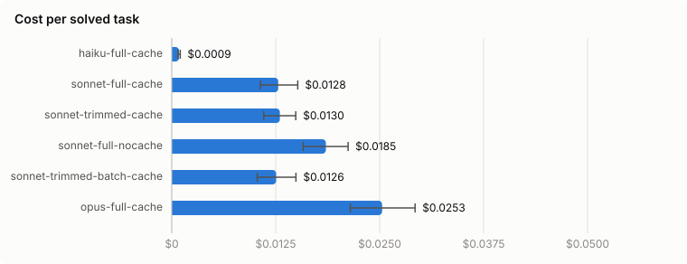
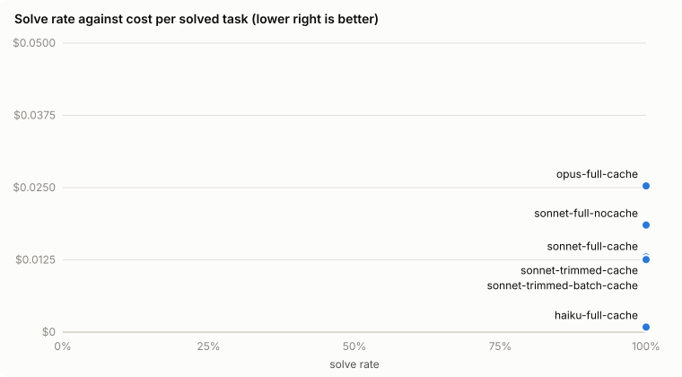
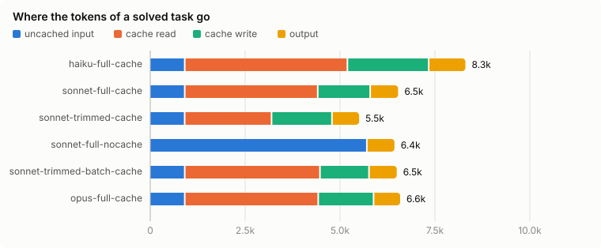

# Benchmark results: claude

360 runs: 20 tasks x 6 configurations, 3 repeats. Generated 2026-11-24 04:06 UTC by `bench/analyze.py`.

## Summary

| Config | Model | Cache opt. | Tool results kept | Solved | Solve rate (95% CI) | Cost per solved task (95% CI) | Tokens per solved task | Cache read share | Median time | Guard stops | Tests edited |
|---|---|---|---|---|---|---|---|---|---|---|---|
| haiku-full-cache | `claude-haiku-5-5` | on | all | 60/60 | 100% (94% to 100%) | $0.0009 ($0.0007 to $0.0010) | 8.3k | 58% | 5s | 0 | 0 |
| sonnet-full-cache | `claude-sonnet-5-5` | on | all | 60/60 | 100% (94% to 100%) | $0.0128 ($0.0107 to $0.0152) | 6.5k | 60% | 6s | 0 | 0 |
| sonnet-trimmed-cache | `claude-sonnet-5-5` | on | last 3 | 60/60 | 100% (94% to 100%) | $0.0130 ($0.0111 to $0.0149) | 5.5k | 48% | 7s | 0 | 0 |
| sonnet-full-nocache | `claude-sonnet-5-5` | off | all | 60/60 | 100% (94% to 100%) | $0.0185 ($0.0158 to $0.0212) | 6.4k | 0% | 6s | 0 | 0 |
| sonnet-trimmed-batch-cache | `claude-sonnet-5-5` | on | last 3, trimmed 4 at a time | 60/60 | 100% (94% to 100%) | $0.0126 ($0.0103 to $0.0149) | 6.5k | 62% | 7s | 0 | 0 |
| opus-full-cache | `claude-opus-5-5` | on | all | 60/60 | 100% (94% to 100%) | $0.0253 ($0.0215 to $0.0293) | 6.6k | 60% | 9s | 0 | 0 |

Cost per solved task is the configuration's total spend divided by the tasks it solved, so failed
and stopped runs count against it. Its interval resamples tasks (with all their repeats). A solve
is checked by the runner with the task's original tests restored.

## Paired against sonnet-full-nocache

The same task and repeat under two configurations, so task difficulty cancels out.

| Config | Pairs | Total cost change | Cheaper on | Solved only here | Solved only by the baseline |
|---|---|---|---|---|---|
| haiku-full-cache | 60 | -95.3% | 60/60 | 0 | 0 |
| sonnet-full-cache | 60 | -30.9% | 59/60 | 0 | 0 |
| sonnet-trimmed-cache | 60 | -29.9% | 52/60 | 0 | 0 |
| sonnet-trimmed-batch-cache | 60 | -32.3% | 59/60 | 0 | 0 |
| opus-full-cache | 60 | +36.5% | 5/60 | 0 | 0 |

## Charts

## Spend

| Config | Runs | Total cost | Cost per run | Uncached input per solved | Cache read per solved | Cache write per solved | Output per solved | Mean turns (solved) | Largest prompt | Runs with an API error |
|---|---|---|---|---|---|---|---|---|---|---|
| haiku-full-cache | 60 | $0.0526 | $0.0009 | 0.9k | 4.3k | 2.1k | 0.9k | 3.9 | 5.2k | 0 |
| sonnet-full-cache | 60 | $0.7685 | $0.0128 | 0.9k | 3.5k | 1.4k | 0.7k | 3.6 | 3.9k | 0 |
| sonnet-trimmed-cache | 60 | $0.7798 | $0.0130 | 0.9k | 2.3k | 1.6k | 0.7k | 3.7 | 3.6k | 27 |
| sonnet-full-nocache | 60 | $1.11 | $0.0185 | 5.7k | 0 | 0 | 0.7k | 3.5 | 3.8k | 0 |
| sonnet-trimmed-batch-cache | 60 | $0.7531 | $0.0126 | 0.9k | 3.6k | 1.3k | 0.7k | 3.6 | 3.9k | 0 |
| opus-full-cache | 60 | $1.52 | $0.0253 | 0.9k | 3.5k | 1.5k | 0.7k | 3.6 | 3.8k | 0 |

## Solved runs per task

| Task | haiku-full-cache | sonnet-full-cache | sonnet-trimmed-cache | sonnet-full-nocache | sonnet-trimmed-batch-cache | opus-full-cache |
|---|---|---|---|---|---|---|
| 001-word-count | 3/3 | 3/3 | 3/3 | 3/3 | 3/3 | 3/3 |
| 002-roman-numerals | 3/3 | 3/3 | 3/3 | 3/3 | 3/3 | 3/3 |
| 003-binary-search | 3/3 | 3/3 | 3/3 | 3/3 | 3/3 | 3/3 |
| 004-interval-merge | 3/3 | 3/3 | 3/3 | 3/3 | 3/3 | 3/3 |
| 005-lru-cache | 3/3 | 3/3 | 3/3 | 3/3 | 3/3 | 3/3 |
| 006-semver-compare | 3/3 | 3/3 | 3/3 | 3/3 | 3/3 | 3/3 |
| 007-csv-line | 3/3 | 3/3 | 3/3 | 3/3 | 3/3 | 3/3 |
| 008-split-bill | 3/3 | 3/3 | 3/3 | 3/3 | 3/3 | 3/3 |
| 009-word-wrap | 3/3 | 3/3 | 3/3 | 3/3 | 3/3 | 3/3 |
| 010-luhn | 3/3 | 3/3 | 3/3 | 3/3 | 3/3 | 3/3 |
| 011-retry-backoff | 3/3 | 3/3 | 3/3 | 3/3 | 3/3 | 3/3 |
| 012-token-bucket | 3/3 | 3/3 | 3/3 | 3/3 | 3/3 | 3/3 |
| 013-brackets | 3/3 | 3/3 | 3/3 | 3/3 | 3/3 | 3/3 |
| 014-template | 3/3 | 3/3 | 3/3 | 3/3 | 3/3 | 3/3 |
| 015-topo-sort | 3/3 | 3/3 | 3/3 | 3/3 | 3/3 | 3/3 |
| 016-config-merge | 3/3 | 3/3 | 3/3 | 3/3 | 3/3 | 3/3 |
| 017-inventory | 3/3 | 3/3 | 3/3 | 3/3 | 3/3 | 3/3 |
| 018-duration-parse | 3/3 | 3/3 | 3/3 | 3/3 | 3/3 | 3/3 |
| 019-percentile | 3/3 | 3/3 | 3/3 | 3/3 | 3/3 | 3/3 |
| 020-markdown-table | 3/3 | 3/3 | 3/3 | 3/3 | 3/3 | 3/3 |

## Runaway guard

Runs the guard stopped, how many calls they made (the refused call included) and what they cost.

| Config | Runs stopped | Mean calls when stopped | Cost of stopped runs | Warned, not stopped |
|---|---|---|---|---|
| haiku-full-cache | 0 | - | $0 | 0 |
| sonnet-full-cache | 0 | - | $0 | 0 |
| sonnet-trimmed-cache | 0 | - | $0 | 0 |
| sonnet-full-nocache | 0 | - | $0 | 0 |
| sonnet-trimmed-batch-cache | 0 | - | $0 | 0 |
| opus-full-cache | 0 | - | $0 | 0 |

## Task inference

Every run sent its own `x-pitwall-task` header, which is the ground truth. Pitwall also inferred a
task for every call from the conversation alone, as it does for clients that send no header.

- Runs checked: 360
- Grouped correctly (one inferred task, not shared with another run): 360 (100%)
- Split across several inferred tasks: 0
- Merged with another run: 0
