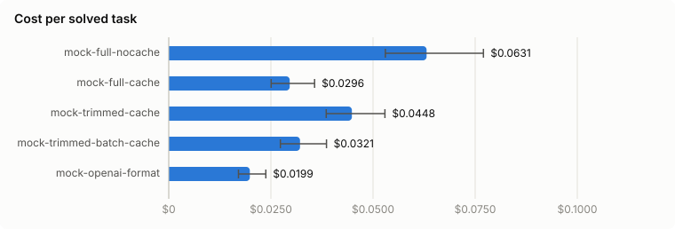
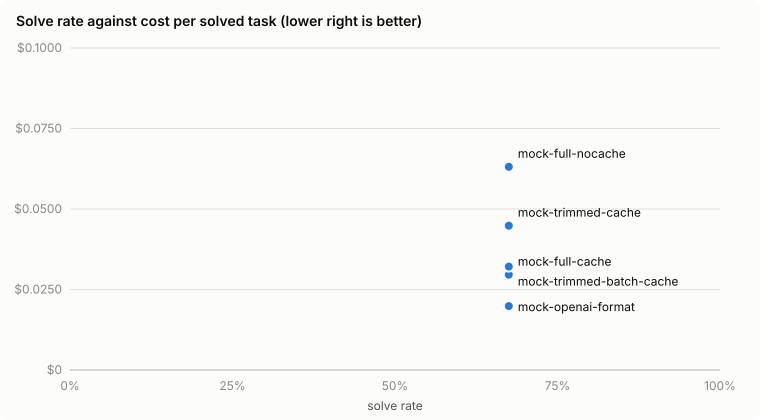
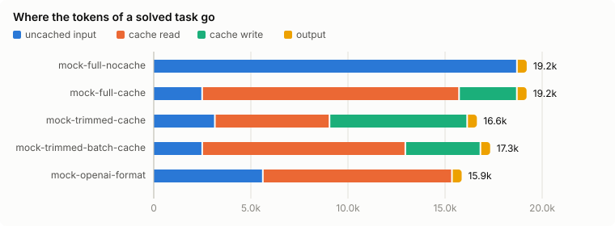

# Benchmark results: dry-run

> **Dry run on the mock provider.** Outcomes were scripted: on each task and repeat the mock
> replays the reference fix, loops, rewrites the tests, or gives up, the same choice for every
> configuration. Solve rates therefore say nothing about any model; token counts, costs, cache
> use and guard stops are what the gateway measured for those scripted runs.

200 runs: 20 tasks x 5 configurations, 2 repeats. Generated 2026-11-24 04:06 UTC by `bench/analyze.py`.

## Summary

| Config | Model | Cache opt. | Tool results kept | Solved | Solve rate (95% CI) | Cost per solved task (95% CI) | Tokens per solved task | Cache read share | Median time | Guard stops | Tests edited |
|---|---|---|---|---|---|---|---|---|---|---|---|
| mock-full-nocache | `mock-claude` | off | all | 27/40 | 68% (52% to 80%) | $0.0631 ($0.0530 to $0.0770) | 19.2k | 0% | 1s | 4 | 2 |
| mock-full-cache | `mock-claude` | on | all | 27/40 | 68% (52% to 80%) | $0.0296 ($0.0251 to $0.0357) | 19.2k | 71% | 1s | 4 | 2 |
| mock-trimmed-cache | `mock-claude` | on | last 2 | 27/40 | 68% (52% to 80%) | $0.0448 ($0.0386 to $0.0529) | 16.6k | 36% | 1s | 4 | 2 |
| mock-trimmed-batch-cache | `mock-claude` | on | last 2, trimmed 4 at a time | 27/40 | 68% (52% to 80%) | $0.0321 ($0.0273 to $0.0386) | 17.3k | 62% | 1s | 4 | 2 |
| mock-openai-format | `mock-gpt` | off | all | 27/40 | 68% (52% to 80%) | $0.0199 ($0.0171 to $0.0238) | 15.9k | 63% | 1s | 4 | 2 |

Cost per solved task is the configuration's total spend divided by the tasks it solved, so failed
and stopped runs count against it. Its interval resamples tasks (with all their repeats). A solve
is checked by the runner with the task's original tests restored.

## Paired against mock-full-nocache

The same task and repeat under two configurations, so task difficulty cancels out.

| Config | Pairs | Total cost change | Cheaper on | Solved only here | Solved only by the baseline |
|---|---|---|---|---|---|
| mock-full-cache | 40 | -53.1% | 35/40 | 0 | 0 |
| mock-trimmed-cache | 40 | -29.0% | 35/40 | 0 | 0 |
| mock-trimmed-batch-cache | 40 | -49.1% | 35/40 | 0 | 0 |
| mock-openai-format | 40 | -68.5% | 40/40 | 0 | 0 |

## Charts

## Spend

| Config | Runs | Total cost | Cost per run | Uncached input per solved | Cache read per solved | Cache write per solved | Output per solved | Mean turns (solved) | Largest prompt | Runs with an API error |
|---|---|---|---|---|---|---|---|---|---|---|
| mock-full-nocache | 40 | $1.70 | $0.0426 | 18.7k | 0 | 0 | 0.5k | 9.1 | 6.1k | 0 |
| mock-full-cache | 40 | $0.7993 | $0.0200 | 2.5k | 13.2k | 3.0k | 0.5k | 9.1 | 6.1k | 0 |
| mock-trimmed-cache | 40 | $1.21 | $0.0303 | 3.2k | 5.9k | 7.1k | 0.5k | 9.1 | 4.3k | 0 |
| mock-trimmed-batch-cache | 40 | $0.8673 | $0.0217 | 2.5k | 10.5k | 3.9k | 0.5k | 9.1 | 5.1k | 0 |
| mock-openai-format | 40 | $0.5361 | $0.0134 | 5.7k | 9.7k | 0 | 0.5k | 9.1 | 4.2k | 0 |

## Solved runs per task

| Task | mock-full-nocache | mock-full-cache | mock-trimmed-cache | mock-trimmed-batch-cache | mock-openai-format |
|---|---|---|---|---|---|
| 001-word-count | 1/2 | 1/2 | 1/2 | 1/2 | 1/2 |
| 002-roman-numerals | 1/2 | 1/2 | 1/2 | 1/2 | 1/2 |
| 003-binary-search | 1/2 | 1/2 | 1/2 | 1/2 | 1/2 |
| 004-interval-merge | 1/2 | 1/2 | 1/2 | 1/2 | 1/2 |
| 005-lru-cache | 2/2 | 2/2 | 2/2 | 2/2 | 2/2 |
| 006-semver-compare | 1/2 | 1/2 | 1/2 | 1/2 | 1/2 |
| 007-csv-line | 2/2 | 2/2 | 2/2 | 2/2 | 2/2 |
| 008-split-bill | 2/2 | 2/2 | 2/2 | 2/2 | 2/2 |
| 009-word-wrap | 1/2 | 1/2 | 1/2 | 1/2 | 1/2 |
| 010-luhn | 2/2 | 2/2 | 2/2 | 2/2 | 2/2 |
| 011-retry-backoff | 2/2 | 2/2 | 2/2 | 2/2 | 2/2 |
| 012-token-bucket | 2/2 | 2/2 | 2/2 | 2/2 | 2/2 |
| 013-brackets | 1/2 | 1/2 | 1/2 | 1/2 | 1/2 |
| 014-template | 1/2 | 1/2 | 1/2 | 1/2 | 1/2 |
| 015-topo-sort | 0/2 | 0/2 | 0/2 | 0/2 | 0/2 |
| 016-config-merge | 2/2 | 2/2 | 2/2 | 2/2 | 2/2 |
| 017-inventory | 1/2 | 1/2 | 1/2 | 1/2 | 1/2 |
| 018-duration-parse | 1/2 | 1/2 | 1/2 | 1/2 | 1/2 |
| 019-percentile | 1/2 | 1/2 | 1/2 | 1/2 | 1/2 |
| 020-markdown-table | 2/2 | 2/2 | 2/2 | 2/2 | 2/2 |

## Runaway guard

Runs the guard stopped, how many calls they made (the refused call included) and what they cost.

| Config | Runs stopped | Mean calls when stopped | Cost of stopped runs | Warned, not stopped |
|---|---|---|---|---|
| mock-full-nocache | 4 | 7.2 | $0.0686 | 0 |
| mock-full-cache | 4 | 7.2 | $0.0433 | 0 |
| mock-trimmed-cache | 4 | 11.0 | $0.0923 | 0 |
| mock-trimmed-batch-cache | 4 | 7.2 | $0.0452 | 0 |
| mock-openai-format | 4 | 7.2 | $0.0276 | 0 |

## Task inference

Every run sent its own `x-pitwall-task` header, which is the ground truth. Pitwall also inferred a
task for every call from the conversation alone, as it does for clients that send no header.

- Runs checked: 200
- Grouped correctly (one inferred task, not shared with another run): 200 (100%)
- Split across several inferred tasks: 0
- Merged with another run: 0
