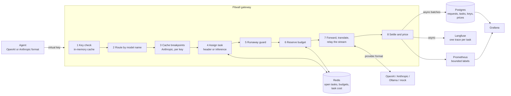

# Architecture

Pitwall is one Go binary between coding agents and model providers. Agents
point their base URL at it and keep their own API format; Pitwall checks the
key, works out which task the call belongs to, checks the guard and the
budget, forwards the call (translating formats when the provider speaks the
other one), and records what it cost. Everything that isn't needed to answer
the agent happens after the response, off the request path.

## A call through the gateway

1. **Key check.** `pw-` virtual keys are stored as SHA-256 hashes; a small
   cache keeps lookups off Postgres. Each key carries allowed models, a
   monthly budget, its team and whether the cache optimizer is on.
2. **Route.** Model-name globs pick the provider (`claude-*` to Anthropic,
   `gpt-*` to OpenAI, `ollama/*` to a local Ollama, `mock-*` to the mock).
3. **Cache breakpoints.** For Anthropic requests with no `cache_control`
   of their own, two markers: after the tools and system prompt, and on the
   newest turn ([0004](decisions/0004-cache-optimizer-and-guard.md)).
4. **Task.** An `x-pitwall-task` header names the task. Without one,
   Pitwall infers it from the conversation: a call whose earlier messages
   match a task's last call continues that task
   ([0003](decisions/0003-task-traces.md)). The task ID goes back in
   `x-pitwall-task-id`.
5. **Guard.** Reads the conversation the call resends: the same step with
   the same result repeated, the same tool call repeated, prompt size, and
   the task's cost so far. A warning is a response header; a stop is a 400
   the agent shows its user.
6. **Budget.** Reserves the call's worst case (prompt plus `max_tokens` at
   list price) against the key's and the team's monthly budgets in one Redis
   script; a call that doesn't fit gets a 402 and never reaches the
   provider ([0002](decisions/0002-keys-metering-budgets.md)).
7. **Forward.** Same-format calls pass through byte for byte; cross-format
   calls are translated, streams included, tool calls included
   ([0001](decisions/0001-format-translation.md)). Usage is read from the
   response or stream; if a provider sends none, tokens are estimated and
   the row is marked estimated.
8. **Settle.** The reservation is replaced by the real cost, from the
   provider's usage and the price table. The call's row goes to an async
   writer that batches inserts into Postgres, and is folded into its task:
   calls, cost, tokens, context growth, repeated input, guard events.

The hot path touches Redis twice (task, budget) and Postgres only when a key
isn't in the cache; records are written after the response, so a slow
Postgres or Langfuse doesn't slow calls down. Measured overhead is in
[bench/results/load](../bench/results/load/results.md).

## Data

| Store | What | Why there |
|---|---|---|
| Postgres | `requests` (one row per call), `tasks` (one row per agent run), keys, users, teams, price history | durable, queried by the admin API, Grafana and the benchmark |
| Redis | open tasks and their prefix hashes, budget counters and reservations, per-task cost for the guard | shared, atomic, short-lived |
| Langfuse | a trace per task, a generation per call (redacted) | reading what an agent did |
| Prometheus | call, token, cost, cache and guard counters by provider and model | rates and alerts; never per task |

## The benchmark around it

The harness benchmark ([bench/](../bench/README.md)) runs Pitwall's own
agent on 20 small Go tasks through the gateway, one virtual key per
configuration under a team budget, and reads cost per task back from the
admin API. Results and method: [bench/results/findings.md](../bench/results/findings.md).

## Design questions

**Which task does a call belong to when the agent sends no header, and how
accurate is it?** Agents resend the whole conversation each turn, so a call
continues the task whose last call is a prefix of it. Pitwall stores
cumulative hashes of each open task's messages in Redis (per key) and
matches the new call's prefix against them; a short conversation that
shrinks or repeats the first message starts a new task, and five idle
minutes close one. On the benchmark, where every run also sent a header as
ground truth, inference grouped 360 of 360 real runs and 200 of 200 dry
runs correctly. Each key rarely had more than two runs in flight, so heavy
concurrency on one key is untested.

**Where do the cache breakpoints go, and when does caching cost more?**
After the tools and system prompt, and on the newest turn, within each
model's minimum cacheable length. A cache write costs 1.25 times plain
input, so caching loses when a prefix is written and never read: one-call
tasks, prompts under the minimum, or history that changes every turn.
Trimming old tool output every turn did exactly that on the mock, costing
51% more than keeping the history.

**How do you tell a stuck agent from one that is legitimately retrying?**
By what changes between attempts. The strict signal counts the same tool
call with the same (normalized) result in a row: an edit between test runs,
or a different result, breaks the run. Repeating a call whose result keeps
changing (polling) only counts toward a looser limit. Normalization drops
IDs, digits and line order so timing noise doesn't hide a loop.

**How do you count tokens on a stream, and what if the provider sends no
usage?** From the usage the stream itself carries: Anthropic's
`message_start` and `message_delta`, OpenAI's final chunk (Pitwall asks for
it with `stream_options.include_usage` and strips it if the client didn't).
With no usage, it counts the prompt and output text with a tokenizer and
marks the row estimated.

**Ten calls arrive at once for a key with $1 left. What happens?** Each
call reserves its worst-case cost atomically in Redis. Calls are admitted
until the reservations fill the remaining dollar; the rest get a 402
without reaching the provider. As calls finish, the real cost replaces
each reservation and the difference is released for the next calls.

**Why can't task IDs be Prometheus labels?** Every task would create new
time series that never go away, so memory grows without bound. Prometheus
gets bounded labels (provider, priced model name, status, signal);
per-task data lives in Postgres and Langfuse.

**How noisy are the benchmark results?** Three repeats per task and
configuration. Comparisons are paired by task and repeat, which removes
task difficulty; cost per solved task gets a bootstrap interval over tasks
and solve rates a Wilson interval. The paired Sonnet cache comparison was
cheaper on 59 of 60 runs; the trimming variants were within noise.

**How is this different from LiteLLM?** LiteLLM meters and budgets per
request and key. Pitwall's unit is the agent's task: cost per task and per
solved task, context growth, repeated input, a guard that reads the
conversation, and cache markers added for clients that don't. Overhead
against LiteLLM is measured in
[bench/results/load](../bench/results/load/results.md).
